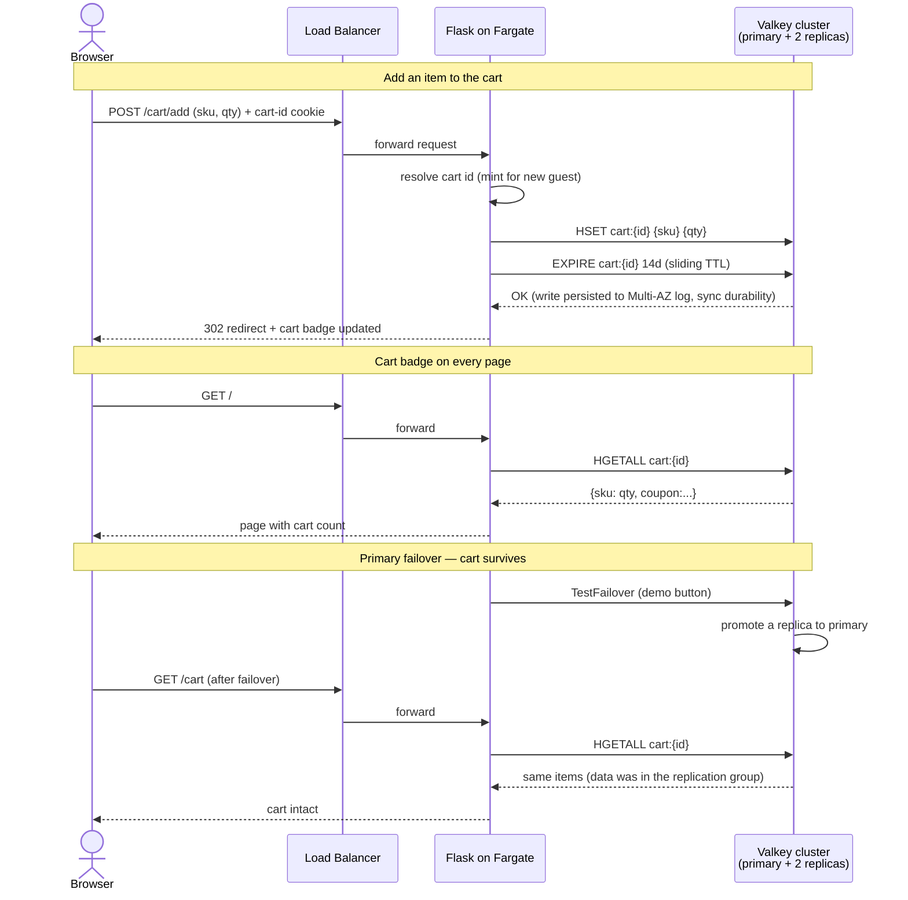

# Durable Session Store on Amazon ElastiCache for Valkey 9.1 — One-Pager

## What this sample is

A deployable, production-shaped reference that shows how to build a **durable,
secure, server-side session store** on **Amazon ElastiCache for Valkey 9.1**,
demonstrated through a small e-commerce **storefront with a shopping cart**.

The headline property: **the cart survives app restarts and a primary
failover**, because cart state lives in the Valkey cluster — not in the app's
memory and not in the browser cookie. The browser holds only an opaque,
unguessable cart-id cookie (plus a signed session cookie with the username after
login); the durable data sits in the
cluster under a dedicated `cart:{id}` hash.

It ships as two halves:

- **`app/`** — a Flask storefront (catalog with generated SVG thumbnails, a
  cart with add / update / remove / save-for-later / coupons, a login flow, and
  a `/healthz` probe). It talks to the cluster with a cluster-aware `redis-py`
  client.
- **`infra/`** — an AWS CDK (TypeScript) stack that provisions everything in one
  deploy: the Valkey cluster plus the app on ECS Fargate behind a load balancer.

## The durability use case

Session and cart state is read on nearly every page and written constantly
during a sale. Keeping it in a database adds latency exactly where conversion is
most sensitive; keeping it only in app memory or a cookie means it is lost on a
restart, a deploy, or a node failover. A durable, in-memory store is the fit:

- **Shopping carts** (this sample) — customers return to a full cart; guest
  carts tied to a cookie merge into the account on login.
- Checkout / payment sessions, token-revocation lists, AI-agent session state,
  banking/trading step-up sessions, gaming player sessions, and large-scale
  login sessions follow the same pattern (see the project notes).

### How the cart is modeled

| Concern | Design |
|---|---|
| Line items | one hash per cart: `HSET cart:{id} {sku} {qty}` |
| Coupons | namespaced fields in the same hash: `coupon:{code}` |
| Saved for later | sibling hash `saved:{id}` |
| TTL | sliding, 14 days, refreshed on every write |
| Guest carts | `cart:guest:{token}`, where the token is server-minted and validated on every request (a separate namespace from account carts) |
| Guest → account | on login the guest cart merges into `cart:user:{userId}` (**account-wins** on conflicting SKUs); the guest cart is then deleted |

### Why Valkey 9.1 cluster, this shape

- **Cluster mode enabled**, one shard: **1 primary + 2 replicas** across AZs.
- **Synchronous durability** (`durability: sync`): a write is acknowledged only
  after it is persisted to the Multi-AZ transactional log, so an acknowledged
  cart change survives a primary loss.
- **Multi-AZ automatic failover**, **TLS in transit**, **at-rest encryption**
  with a customer-managed KMS key, and an **AUTH token** kept in Secrets Manager.

## Architecture

```
Browser ──HTTP──▶ Application Load Balancer (public subnets)
                      │
                      ▼
            ECS Fargate tasks  (private subnets, cluster-aware redis-py)
                      │  TLS + AUTH, 6379
                      ▼
        ElastiCache for Valkey 9.1  (isolated subnets)
        cluster mode enabled · 1 primary + 2 replicas · sync durability
```

## Request flow (add to cart, then fail over)



## How to deploy and use it

Prerequisites: an AWS account, the AWS CDK, Node.js, Python 3.12, and a working
Docker daemon (the image is built at deploy time).

```bash
# 1. Point at your account/region and bootstrap CDK once.
cd infra
npm install
export CDK_DEFAULT_ACCOUNT=<account-id>
export CDK_DEFAULT_REGION=us-east-1
npx cdk bootstrap aws://$CDK_DEFAULT_ACCOUNT/$CDK_DEFAULT_REGION

# 2. Verify, then deploy the whole stack (cluster + app + load balancer).
#    You need your network's CIDR (synth) and an ACM cert ARN (deploy).
CIDR=203.0.113.0/24   # your office / VPN range; 0.0.0.0/0 is rejected
CERT_ARN=arn:aws:acm:us-east-1:<account-id>:certificate/<id>
npm run build && npm test
npx cdk synth  -c allowedCidr=$CIDR                                  # cdk-nag runs
npx cdk deploy -c allowedCidr=$CIDR --parameters CertificateArn=$CERT_ARN   # ~15-20 min

# 3. Open the storefront. The deploy prints:
#    StorefrontUrl = https://<load-balancer-dns>
```

Then, in the browser:

1. Browse the catalog and **add items to the cart**.
2. Apply a coupon, **save an item for later**, log in with any username
   (your guest cart merges into the account cart).
3. Click **Fail over the primary** (the durability demo button) and reload the
   cart — it is unchanged, because it lived in the cluster, not the node that
   stepped down.

Validate the cluster from the CLI (read-only):

```bash
RG=$(aws elasticache describe-replication-groups \
  --query "ReplicationGroups[?contains(Description,'session store')].ReplicationGroupId | [0]" \
  --output text)
aws elasticache describe-replication-groups --replication-group-id "$RG" \
  --query "ReplicationGroups[0].{Status:Status, ClusterEnabled:ClusterEnabled, \
Members:length(NodeGroups[0].NodeGroupMembers), Durability:EffectiveDurability}" \
  --output table
# expect: available · True · 3 · sync
```

Tear down when finished (stops all charges; the KMS key is retained):

```bash
cd infra && npx cdk destroy
```

## Cost & safety notes

- Deploying creates **billable** resources: 3 cache nodes, a NAT gateway, a load
  balancer, and 2 Fargate tasks. Destroy when done.
- The load balancer is **HTTPS only** (443, TLS 1.3) and accepts traffic only
  from the `allowedCidr` you pass at deploy; both a certificate ARN and that
  CIDR are required.
- The failover button is a disruptive, opt-in demo action
  (`ENABLE_FAILOVER_DEMO`); it is POST-only and scoped to this one cluster.
- **This is a demo, not a production app.** Login accepts any username with no
  password. Before real use, add a real identity provider (e.g. Amazon Cognito)
  and the other hardening in the README's
  [Before you go to production](README.md#before-you-go-to-production) section.

---
*Content adapted from AWS public documentation and the aws-samples session-store
tutorial; rephrased for compliance with licensing restrictions.*
