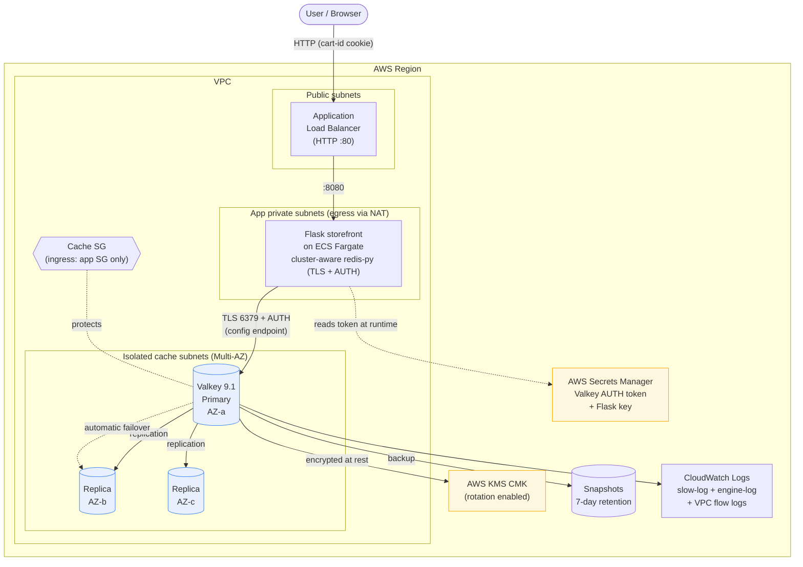

# Durable Session Store on Amazon ElastiCache for Valkey 9.1

A production-shaped example of a **durable, secure, server-side session store**
built on **Amazon ElastiCache for Valkey 9.1**. It expands the
[aws-samples/amazon-elasticache-samples](https://github.com/aws-samples/amazon-elasticache-samples)
`session-store` tutorial into a hardened reference you can deploy.

> Content adapted from AWS public documentation and the aws-samples session-store
> tutorial; rephrased for compliance with licensing restrictions.

## What you get

- **Flask storefront** (`app/`) &mdash; a small demo shop (static product catalog
  with generated SVG thumbnails + a shopping cart) whose cart is stored in a
  **dedicated `cart:{id}` hash in the Valkey cluster**, not in the browser cookie
  or app memory. The cookie carries only a small guest cart id and, after login,
  a username; the durable cart lives in Valkey and survives app restarts and
  failover.
- **AWS CDK (TypeScript) infrastructure** (`infra/`) that provisions the whole
  thing in one deploy: the encrypted, durable Valkey 9.1 cluster **and** the app
  on ECS Fargate behind an internet-facing load balancer.
- **Tests**: Python unit/route tests against `fakeredis` (incl. the cart
  repository and guest→account merge), and CDK assertion tests.
- **Security scanning**: ruff, bandit, pip-audit, and cdk-nag (commands under
  "Local development" and "Deploying the whole stack").

## The demo: a cart that survives a restart

The storefront makes the value of a durable session store tangible. Browse the
catalog, add a few items to your cart, then **restart the app process** &mdash;
your cart is still there.

That works because the cart is kept in a dedicated **`cart:{id}` hash in Valkey**
(`HSET cart:{id} {sku} {qty}`), not in the app's memory or the browser cookie.
The cookie holds only the cart id. When the app restarts, the new process reads
the same hash back out of ElastiCache. In production the same mechanism is what
lets carts survive an AZ failover: a replica is promoted and the data is already
there.

The cart is modeled per the shopping-cart pattern:

| Concern | Design |
|---|---|
| Line items | one hash per cart: `HSET cart:{id} {sku} {qty}` |
| Coupons | namespaced fields in the same hash: `coupon:{code}` |
| Saved for later | sibling hash `saved:{id}` |
| TTL | sliding, 14 days, refreshed on every write |
| Guest carts | `cart:guest:{token}`, where the token is server-minted and validated on every request (a separate namespace from account carts) |
| Guest → account | on login the guest cart merges into `cart:user:{username}` (**account-wins** on conflicting SKUs), then the guest cart is deleted |

Routes:

| Route | Purpose |
|---|---|
| `GET /` | Product catalog grid |
| `GET /product/<id>` | Product detail page |
| `GET /thumbnail/<id>.svg` | Generated SVG thumbnail (no binary assets) |
| `GET /cart` | View the cart with line items, coupons, saved-for-later, total |
| `POST /cart/add` · `/cart/update` · `/cart/remove` · `/cart/clear` | Mutate the cart |
| `POST /cart/save` · `/cart/move` | Save for later / move back to cart |
| `POST /cart/coupon` | Apply a promo code |
| `GET/POST /login`, `GET /logout` | Associate a name with the session (triggers cart merge) |
| `GET /healthz` | Backend reachability probe |

Try the restart demo locally: with the app running (see "Local development") and
items in your cart, stop the Flask process with Ctrl-C, start it again, and
reload `/cart` — the cart is unchanged because it lives in Valkey. On the
deployed stack, use the **Fail over the primary** button instead (below).

### Optional: the "fail over the primary" button

For a live audience against a deployed ElastiCache cluster, the cart page can
show a **Fail over the primary** button. Clicking it calls ElastiCache
[`TestFailover`](https://docs.aws.amazon.com/AmazonElastiCache/latest/APIReference/API_TestFailover.html)
to promote a replica to primary for the shard. The cart stays intact across the
failover, because the session lives in the replication group rather than on the
node that stepped down.

This is a **disruptive, control-plane action and is OFF by default.** It is
guarded several ways:

- Shown and executed only when `ENABLE_FAILOVER_DEMO=true`; otherwise the route
  is inert (returns 403 without calling AWS) and the button is hidden.
- The route is **POST-only** (a link or prefetch cannot trigger it) and the
  button asks for confirmation.
- It uses the application's own IAM credentials, which must grant
  `elasticache:TestFailover`. Nothing is hardcoded.
- `boto3` is only needed for this demo; it is in `requirements-demo.txt`, not the
  core runtime requirements.

Enable it (against a deployed cluster) with:

```bash
pip install -r requirements-demo.txt
export ENABLE_FAILOVER_DEMO=true
export REDIS_REPLICATION_GROUP_ID=<replication group id>
export REDIS_NODE_GROUP_ID=0001          # the shard to fail over
export AWS_REGION=<region>
```

> Do not enable this on anything shared or public. Leave it off for every
> other deployment.

## Architecture



**Request flow:** the browser reaches the load balancer, which forwards to the
Flask app on Fargate. The app reads and writes the cart in the Valkey cluster
over a cluster-aware TLS + AUTH connection to the configuration endpoint. If the
primary fails, ElastiCache promotes a replica automatically; because the cart
lives in the replication group (not in the app or the cookie), it survives both
app restarts and failover. Snapshots provide point-in-time recovery.

## Why it is durable

Durability comes from the ElastiCache replication group configuration, not the
engine version:

| Control | Setting |
|---|---|
| Cluster mode enabled | `clusterMode: 'enabled'`, one shard (`numNodeGroups: 1`) |
| Replicas across AZs | 1 primary + 2 replicas (`replicasPerNodeGroup: 2`) |
| Synchronous durability | `durability: 'sync'` (ack only after the Multi-AZ log persists the write) |
| Multi-AZ with automatic failover | `multiAzEnabled: true`, `automaticFailoverEnabled: true` |
| Automatic snapshots | 7-day retention, nightly backup window |
| Point-in-time recovery | restore from snapshot |

Because the cluster runs **cluster mode enabled**, the app connects with a
cluster-aware client (`redis.cluster.RedisCluster`) to the configuration
endpoint; set `REDIS_CLUSTER_MODE=true` (the ECS deployment does this for you).

Valkey 9.1 specifically adds `MSETEX` (set multiple keys with a shared TTL in one
round trip) and `HGETDEL` (atomic get-and-delete), both useful for session and
one-time-token workflows.

## Security (AWS best practices)

- **Encryption at rest** with a customer-managed KMS key (automatic rotation).
- **Encryption in transit** required (TLS); the client enforces certificate checks.
- **Authentication** via a Valkey AUTH token generated into **AWS Secrets Manager**
  — never hardcoded or committed. The app reads it from the environment at runtime.
- **Network isolation**: the Valkey cluster sits in private **isolated** subnets
  with no internet path; the app runs in private subnets (egress via NAT) and is
  reached only through the load balancer in the public subnets.
- **Least-privilege networking**: the cache security group accepts traffic only
  from the app's security group on 6379 — no `0.0.0.0/0` ingress to the cache.
- **Secure cookies**: `Secure`, `HttpOnly`, `SameSite=Lax` by default.
- **VPC flow logs** and **CloudWatch** slow-/engine-log delivery enabled.
- **cdk-nag** (`AwsSolutionsChecks`) runs on every synth to enforce guardrails.

No secret values are ever stored in source. `.env` is git-ignored; `.env.example`
documents the variables.

## Before you go to production

> **This is a demo application.** It shows the durable session-store pattern;
> it is not a hardened e-commerce app. Treat everything below as required work
> before handling real customers or real data.

**Authentication is a placeholder.** "Log in" accepts any username with no
password, so anyone who types a username gets that account's cart. Replace it
with a real identity provider, for example:

- **[Amazon Cognito](https://aws.amazon.com/cognito/)** user pools (hosted UI or
  OIDC), with the ALB's
  [built-in Cognito/OIDC authentication](https://docs.aws.amazon.com/elasticloadbalancing/latest/application/listener-authenticate-users.html)
  in front of the app, or
- your organization's SSO/OIDC provider.

Key the account cart by the provider's stable user id (the `sub` claim), never
by a display name or anything the client sends.

**Never build storage keys from client-controlled input.** An earlier version
of this sample put the guest `cart_id` cookie straight into the same key space
as account carts, so a forged `cart_id=user:alice` cookie gave read/write access
to Alice's cart, and logging in then merged and deleted it. That bug would have
survived adding real authentication. The sample now:

- accepts only cookie values with the exact shape of a server-minted token,
- stores guest carts in a separate `guest:` namespace that can never collide
  with `user:` carts, and
- applies the same validation before the login merge.

Regression tests in `tests/test_app.py` reproduce the takeover and assert it
fails. Apply the same rule to any key you derive from cookies, headers, or form
fields.

**Other production hardening to add:**

- **Cookie integrity:** sign or encrypt the guest cart cookie (or bind it to a
  server-side session) so it can't be guessed, replayed, or swapped.
- **CSRF protection** on every state-changing `POST` (e.g. Flask-WTF / CSRF
  tokens), plus `SameSite=Strict` where the UX allows.
- **AWS WAF** on the load balancer (managed rule groups, rate limiting) and
  **ALB access logs** to S3.
- **Least-privilege network access:** keep the ALB ingress CIDR tight, or make
  the ALB internal behind VPN/Verified Access.
- **Disable the failover demo** (`ENABLE_FAILOVER_DEMO`) and drop the
  `elasticache:TestFailover` permission. It is a disruptive admin action.
- **Rotate secrets** (Valkey AUTH token, Flask key) with a documented runbook,
  and prefer Valkey RBAC users over a single shared AUTH token.
- **Input validation and rate limiting** on cart and coupon endpoints, and real
  coupon validation (codes here are accepted as-is).
- **Monitoring and alarms** on ElastiCache memory, evictions, replication lag,
  and app 5xx rates. Set `maxmemory-policy` to `noeviction` so session keys are
  never silently evicted under memory pressure.

## Repository layout

```
app/            Flask storefront (catalog, cart, session store, routes,
                templates/, static/, generated SVG thumbnails)
infra/          AWS CDK app (TypeScript) + CDK assertion tests
tests/          Python tests (pytest + fakeredis)
ONEPAGER.md     One-page overview with a request-flow sequence diagram
```

## Local development

Requires **Python 3.12** (the security tooling is not yet compatible with 3.14).

```bash
python3.12 -m venv .venv
source .venv/bin/activate
pip install -r requirements-dev.txt

cp .env.example .env          # local-only, plaintext redis

# run tests + security scans
pytest -q
ruff check app tests
bandit -r app
pip-audit -r requirements.txt
```

Run the app against a local redis/valkey:

```bash
# start a local valkey (e.g. docker run -p 6379:6379 valkey/valkey)
export $(grep -v '^#' .env | xargs)
flask --app app.main:app run
```

## Deploying the whole stack

One `cdk deploy` provisions the Valkey cluster **and** the storefront on ECS
Fargate behind a load balancer — no manual app wiring. A working Docker daemon
is required (the container image is built at deploy time).

```bash
cd infra
npm install
export CDK_DEFAULT_ACCOUNT=<account-id>
export CDK_DEFAULT_REGION=us-east-1
npx cdk bootstrap aws://$CDK_DEFAULT_ACCOUNT/$CDK_DEFAULT_REGION   # once per acct+region

# The ALB ingress CIDR must be scoped to your network (never 0.0.0.0/0).
# It is checked at synth time.
CIDR=203.0.113.0/24   # your office / VPN / corporate range

# HTTPS is required. The ACM certificate ARN is a CloudFormation parameter,
# supplied at deploy time (the deploy fails without it).
CERT_ARN=arn:aws:acm:<region>:<account-id>:certificate/<id>

npm test                                                   # CDK assertion tests
npx cdk synth  -c allowedCidr=$CIDR                        # cdk-nag runs
npx cdk deploy -c allowedCidr=$CIDR --parameters CertificateArn=$CERT_ARN   # ~15-20 min
```

When it finishes, open the printed **`StorefrontUrl`** (HTTPS) in a browser and
use the shop end to end. Other outputs:

| CDK output | Meaning |
|---|---|
| `StorefrontUrl` | `https://<load-balancer-dns>` — the app (HTTPS, TLS 1.3) |
| `ConfigurationEndpoint` / `ConfigurationPort` | Valkey cluster config endpoint (`REDIS_HOST` / `REDIS_PORT`) |
| `AuthTokenSecretArn` | Secrets Manager ARN for the Valkey AUTH token |
| `ClientSecurityGroupId` | SG allowed to reach the cache on 6379 |

The deployed app already sets `REDIS_CLUSTER_MODE=true`, `REDIS_SSL=true`, and
injects the AUTH token and Flask key from Secrets Manager.

> Deploying creates billable resources (3 ElastiCache nodes, a NAT gateway, a
> load balancer, 2 Fargate tasks, a KMS key). Run `npx cdk destroy` when done.
> The KMS key uses a `RETAIN` removal policy, so it survives stack deletion.

See [`infra/DEPLOY.md`](infra/DEPLOY.md) for the full runbook and validation
steps, and [`ONEPAGER.md`](ONEPAGER.md) for an overview with a request-flow
sequence diagram.

## License

MIT-0. See [LICENSE](LICENSE).
