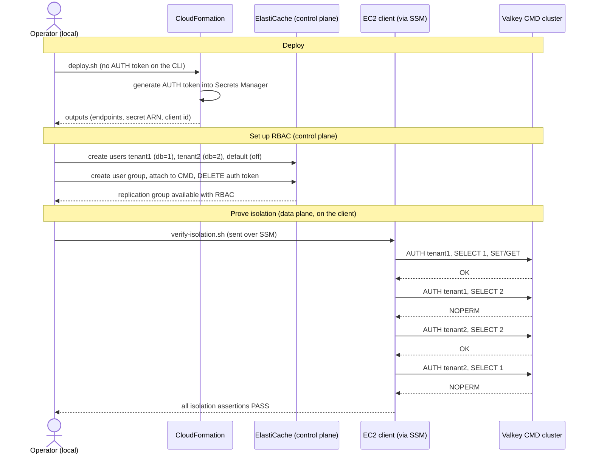

# Multi-Tenant Isolation with Amazon ElastiCache for Valkey — One-Pager

## What this sample is

A deployable, security-hardened code sample that shows how to run **many tenants
on a single Amazon ElastiCache for Valkey cluster** while guaranteeing that one
tenant can never read or modify another tenant's data.

The headline property: **isolation is enforced by the engine, not by application
convention.** Each tenant authenticates as its own Role-Based Access Control
(RBAC) user that is locked to a single numbered database with the Valkey 9.1
`db=` ACL rule. A tenant that tries
to touch another tenant's database gets a hard `NOPERM` error from the server.

It ships as a **CLI demo** and an optional **browser demo**:

- **`cloudformation/`** — a hardened base stack (private VPC, an EC2 client
  reachable only through Session Manager, and two Valkey clusters) plus an
  optional app stack (ECS Fargate + HTTPS ALB).
- **`scripts/`** — bash scripts that deploy, run the isolation demo end to end,
  deploy the browser app, and tear everything down.
- **`app/`** — a Flask multi-tenant storefront: sign in as a tenant and the app
  connects to the shared cluster **as that tenant's RBAC user**, so selecting
  "peek at another tenant" returns a `NOPERM` error from the engine.
- **`docs/`** — the concepts and a step-by-step walkthrough.

## The multi-tenancy use case: high-volume B2C / large-scale SaaS

Sharing one cluster across many small tenants cuts cost sharply versus a cluster
per tenant, and a single cluster holds up to 10,000 numbered databases
(serverless: 1,024) — one per tenant.

See [`docs/01-concepts.md`](./docs/01-concepts.md) for the full use case, the
cost rationale, and how to shard tenants across a fleet of clusters.

The boundary rests on two Valkey features — **numbered databases (9.0)** and the
**`db=` database-level ACL rule (9.1)**. See
[`docs/01-concepts.md`](./docs/01-concepts.md) for how they work.

### How tenants are modeled

| Concern | Design |
|---|---|
| Tenant keyspace | one numbered database per tenant (`tenant1` → db 1, `tenant2` → db 2) |
| Tenant login | an RBAC user with access string `on ~* +@all db=<n>` |
| Default user | a disabled `default` user (`off`), so no unauthenticated access |
| Scope of impact | a single-database tenant cannot run `FLUSHALL` (needs `alldbs`); `FLUSHDB` only clears its own database |
| Enforcement | cross-database `SELECT` returns `NOPERM` from the engine |

### Why this cluster shape

- **Cluster Mode Disabled (CMD) cluster**: numbered databases (up to 10,000),
  migrated from an AUTH token to RBAC so per-tenant `db=` ACLs apply. This is the
  cluster the demo secures.
- **Cluster Mode Enabled (CME) cluster**: created with the `cluster-databases`
  parameter to show numbered databases now work in cluster mode too.
- Both clusters: **TLS required** in transit, **customer-managed KMS** at rest,
  an **AUTH token generated into Secrets Manager**, isolated subnets, and
  slow-/engine-log delivery.

## Architecture

```
          ┌──────────── VPC 10.0.0.0/16 (no internet path) ────────────┐
          │                                                            │
  SSM ───▶│  EC2 client ──443──▶ Interface VPC endpoints               │
 (you)    │  (valkey-cli)        (SSM · Secrets Manager · KMS · ...)    │
          │       │                                                    │
          │       └──6379 TLS+AUTH──▶ ElastiCache for Valkey           │
          │                           • CMD  (numbered dbs, RBAC)      │
          │                           • CME  (cluster-databases)       │
          │  Secrets Manager: AUTH token (KMS-encrypted, generated)    │
          └────────────────────────────────────────────────────────────┘

   tenant1 ──AUTH tenant1──▶ db=1 only   (NOPERM on any other db)
   tenant2 ──AUTH tenant2──▶ db=2 only   (NOPERM on any other db)
```

No internet gateway, no NAT, no public IPs: the private client reaches AWS APIs
and AWS Systems Manager (SSM) Session Manager only through interface VPC
endpoints.

## Request flow (set up a tenant, then prove isolation)



The client fetches the AUTH token from Secrets Manager with its own IAM role, so
the token's plaintext value never passes through the SSM command text.

## How to deploy and use it

Prerequisites: an AWS account (sandbox, not production), AWS CLI v2 with the
Session Manager plugin, and a Region where ElastiCache for Valkey 9.1 is
available. All scripts also run from AWS CloudShell. The browser demo also needs
Docker and an ACM certificate.

```bash
# 1. Deploy the hardened base stack (~5-10 min for the clusters).
./scripts/deploy.sh

# 2. CLI demo: numbered databases → RBAC setup → isolation proof.
./scripts/run-demo.sh

# 3. Optional browser demo: internal ALB + Fargate + secret rotation.
CERT_ARN=arn:aws:acm:...:certificate/<id> ./scripts/deploy-app.sh
./scripts/port-forward.sh          # SSM tunnel -> https://localhost:8443/

# 4. Tear everything down (app stack first, then the rest).
./scripts/cleanup.sh
```

At `https://localhost:8443/` (through the SSM tunnel): sign in as any tenant,
add items to its database, then click **Attempt to peek** at another tenant's
database and watch the engine return `NOPERM`. **Attempt FLUSHALL** is denied
too (a single-db tenant lacks `alldbs`).

Validate the deployed cluster's security posture from the CLI (read-only):

```bash
RG=$(aws cloudformation describe-stacks --stack-name valkey-multi-tenant \
  --query "Stacks[0].Outputs[?OutputKey=='CmdReplicationGroupId'].OutputValue" \
  --output text)
aws elasticache describe-replication-groups --replication-group-id "$RG" \
  --query "ReplicationGroups[0].{Status:Status, \
AtRest:AtRestEncryptionEnabled, Transit:TransitEncryptionEnabled, \
UserGroups:UserGroupIds}" --output table
# expect: available · true · true · ["mt-tenants"]
```

## Security at a glance

Encryption at rest and in transit, all secrets generated into Secrets Manager
with 30-day rotation, a fully private network (no internet path; the ALB is
internal), least-privilege IAM, and checks with IaC, code, and dependency security scanners. The
full control-by-control breakdown is in the README's
[Security section](./README.md#security).

## Cost & safety notes

- The **base stack** creates billable resources: 2 cache nodes, a client
  instance, VPC endpoints, a KMS key, snapshots, and logs — roughly
  **$0.10–0.15/hour**. The optional **browser demo** adds an ALB + 2 Fargate
  tasks, roughly **$0.08/hour** more. Run `cleanup.sh` when done.
- The **KMS key is retained** on teardown by design so encrypted snapshots stay
  recoverable; `cleanup.sh` prints the `schedule-key-deletion` command.
- Use a personal or sandbox account. No secrets are set by hand — tenant
  passwords and the AUTH token are generated into Secrets Manager.
