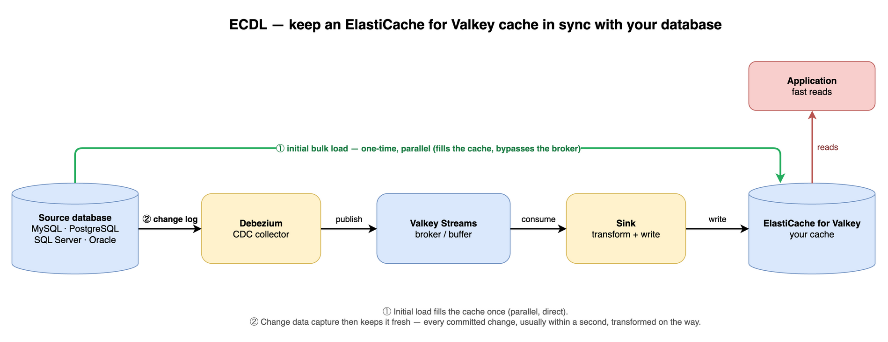

# ElastiCache Data Link (ECDL)

> **This is sample code, for non-production usage.** You should work with your
> security and legal teams to meet your organizational security, regulatory and
> compliance requirements before deployment.

ECDL keeps an Amazon ElastiCache for Valkey cache in sync with your MySQL or
PostgreSQL database. It loads your tables into the cache once, then applies
every committed insert, update and delete, usually within a second, so your
application can read those rows from the cache instead of the database.

**The problem it solves.** Many applications read the same rows (products,
prices, customers, settings) far more often than those rows change. Serving
those reads from a cache takes load off the database and answers in under a
millisecond, but keeping the cache correct is hard. Writing to both the
database and the cache, or expiring cache entries on a timer, still serves
stale or missing data, and building a reliable sync from the database's change
log is work each team ends up doing alone.

- It reads the database's change log; your application's write code does not
  change, and writes still go to the database.
- The database stays the system of record. The cache is a read copy that
  trails it by the time a change takes to arrive.
- It runs in your AWS account. Your source database and your cache stay yours;
  ECDL creates the pipeline between them (a broker, the capture and write
  tasks, and their alarms).
- Optional transforms on the way: row filters, computed fields, column
  selection, renames and denormalization.
- A web console and the `ecdl` command-line tool do the same things: plan,
  deploy, monitor and remove a pipeline.

More in the [one-pager](docs/one-pager.md).

**Status:** release 0.2.31 (`VERSION`). All four source engines have run end
to end, bulk load and live change capture with every row delivered: Aurora
MySQL 8.0, Aurora PostgreSQL 16, SQL Server 2022 and RDS Oracle 19c (see
[Benchmark results](docs/benchmark-results.md)). This release was also tested
live on Aurora MySQL 3 with an ElastiCache for Valkey cluster: bulk load,
inserts, updates and deletes, filters, computed fields, renames, denormalize,
reload, failovers of the broker and the target, and secret rotation. See
[Limitations](#limitations).

**Contents:** [What you need](#what-you-need) · [Deploy in five steps](#deploy-in-five-steps) ·
[Check it offline](#check-it-offline) · [Prepare the database](#prepare-the-database) ·
[Try it with the sample tables](#try-it-with-the-sample-tables) · [Use the console](#use-the-console) ·
[How it works](#how-it-works) · [A link](#a-link) · [Configuration](#configuration) · [CLI](#cli) ·
[When something goes wrong](#when-something-goes-wrong) · [Cost](#cost) · [Limitations](#limitations) ·
[Security](#security) · [What leaves your account](#what-leaves-your-account) ·
[For developers](#for-developers) · [API reference](#api-reference) · [Uninstall](#uninstall) ·
[License](#license)



| Start here | |
|---|---|
| **[Getting started](docs/getting-started.md)** | from an empty account to a running link: publish images, deploy the control plane, create a link, verify, tear down |
| [Prerequisites](docs/prerequisites.md) | what the source, target and network need, per engine |
| [Operations](docs/operations.md) | alarms, troubleshooting, dead-letter replay, changing a running link |
| [One-pager](docs/one-pager.md) | what ECDL is for, in one page |
| [Benchmark results](docs/benchmark-results.md) | measured throughput and freshness, and the setup behind each number |
| [Value formats](docs/value-formats.md) | how each column type is stored in the cache |
| [Try it with the sample tables](#try-it-with-the-sample-tables) | sample tables, a sample link, and a script that makes changes and checks the cache |
| [When something goes wrong](#when-something-goes-wrong) | where each step's error is, and the usual causes |
| [TESTING.md](TESTING.md) | the test suites and how to run them |

The architecture diagram above is `docs/ecdl-architecture.png`; its editable
source is `docs/ecdl-architecture.drawio` (open it in draw.io or
app.diagrams.net).

---

## What you need

**On the machine you deploy from** (macOS or Linux; Windows is not tested):

| Need | Why |
|---|---|
| AWS CLI v2 and credentials for the account | create the stacks, open the UI tunnel |
| Session Manager plugin for the AWS CLI | `ecdl-ui` opens the UI through an SSM port forward |
| Docker with `buildx`, 4 GB of memory or more | `./release.sh push` builds the five images |
| Python 3.9 or later, with `pyyaml` and `boto3` (`ecdl-cli/requirements.txt`) | the `ecdl` CLI |
| A private S3 bucket you own | the link templates the control plane deploys from |

**In the AWS account:**

| Need | Notes |
|---|---|
| A source database: Aurora MySQL 3 / MySQL 8, or Aurora PostgreSQL / PostgreSQL | set up as in [Prepare the database](#prepare-the-database) |
| Its credential in Secrets Manager | an RDS-managed secret works as is |
| A target ElastiCache for Valkey cache, in the same VPC as the pipeline | ECDL never creates the target |
| Subnets that reach ECR, Secrets Manager, CloudWatch and SSM | a NAT gateway or VPC endpoints |
| Permission to create IAM roles (`CAPABILITY_NAMED_IAM`) | the control plane creates its own roles |

---

## Deploy in five steps

You need everything in [What you need](#what-you-need), and the source set up
as in [Prepare the database](#prepare-the-database).

1. **Publish the images into your account** (10–30 min). Nothing is published
   centrally, so this comes first:
   ```bash
   git clone https://github.com/aws-samples/amazon-elasticache-samples.git
   cd amazon-elasticache-samples/tools/elasticache-data-link
   export AWS_REGION=us-east-1
   export ECDL_TEMPLATE_BUCKET=<a private S3 bucket you own>   # the link templates go here
   ./release.sh push
   ```
2. **Deploy the control plane** (about 5 min): one stack, in the VPC of the cache.
   ```bash
   aws cloudformation create-stack --stack-name ecdl-control-plane \
     --template-url https://<the same bucket>.s3.amazonaws.com/templates/<version>/ecdl-control-plane.yaml \
     --capabilities CAPABILITY_NAMED_IAM \
     --parameters ParameterKey=VpcId,ParameterValue=<vpc-id> \
                  ParameterKey=SubnetId,ParameterValue=<subnet-id> \
                  ParameterKey=DeployVpcId,ParameterValue=<vpc-id> \
                  ParameterKey=TemplateBucket,ParameterValue=<the same bucket>
   ```
   The control plane builds every link stack with its own CloudFormation role
   (`ECDLDeploy-<stack>-<region>`) from the templates in that bucket, which it
   may read but not write.
3. **Open the UI**: `ecdl-cli/ecdl-ui ecdl-control-plane --region us-east-1`,
   then http://localhost:3000. There are no inbound ports; the script opens an
   SSM port forward, so IAM decides who can use it.
4. **Create a link** (10–15 min): in the UI, **Define → Build Pipeline**, or
   write the file below and run `ecdl validate`, `ecdl plan`, `ecdl apply`. ECDL
   creates the broker and the pipeline tasks, bulk-loads every table, then
   applies every change.
5. **Check it**: the Pipeline Monitor shows every hop green, and
   `HGETALL <table>:<pk>` on the cache returns the row. Add
   `advanced.alarms.email` to the link to be emailed alarms.

The application then reads from the cache and keeps writing to the database.
To remove a link: **Delete pipeline** in the UI or `ecdl destroy --link <name>`,
before deleting the control-plane stack. Every step in detail, including
sign-in through your own load balancer, is in
[Getting started](docs/getting-started.md). If a step fails, see
[When something goes wrong](#when-something-goes-wrong).

---

## Check it offline

No AWS account and no database needed. From this folder
(`amazon-elasticache-samples/tools/elasticache-data-link`):

```bash
pip install pyyaml boto3
python3 ecdl-cli/ecdl validate samples/link-mysql.yaml          # the link file is valid
python3 ecdl-cli/ecdl validate ecdl-cli/examples/checkout-cache/link.yaml
python3 test_docs.py                                            # the docs match the code
```

`validate` prints `✓ <file> is valid` or names each problem; `test_docs.py` ends with `ok: documentation matches the code`. `make test` runs every automated suite;
see [For developers](#for-developers).

---

## Prepare the database

Once per source, by someone with admin rights on the database. The reasons
behind each setting are in [Prerequisites](docs/prerequisites.md).

**MySQL / Aurora MySQL**

1. In the (cluster) parameter group: `binlog_format=ROW`,
   `binlog_row_image=FULL`, `gtid-mode=ON`, `enforce_gtid_consistency=ON`.
   Reboot to apply.
2. Keep the binlog long enough to recover from an outage of the pipeline:
   ```sql
   CALL mysql.rds_set_configuration('binlog retention hours', 72);
   ```
3. A user for ECDL, its password in Secrets Manager:
   ```sql
   GRANT SELECT ON <database>.* TO 'cdc'@'%';
   GRANT REPLICATION SLAVE, REPLICATION CLIENT ON *.* TO 'cdc'@'%';
   ```
4. The link's signalling table: `ecdl signal ddl <link>.yaml` prints the
   `CREATE TABLE` and its `GRANT SELECT, INSERT`; run both.

**PostgreSQL / Aurora PostgreSQL**

1. `rds.logical_replication=1` in the (cluster) parameter group (elsewhere
   `wal_level=logical`). Reboot to apply.
2. A user for ECDL, its password in Secrets Manager:
   ```sql
   GRANT SELECT ON ALL TABLES IN SCHEMA public TO cdc;
   GRANT rds_replication TO cdc;      -- elsewhere: ALTER ROLE cdc REPLICATION;
   ```
3. `ecdl signal ddl <link>.yaml` prints the signalling table, its grant and
   the link's publication (`CREATE PUBLICATION ecdl_<link>_pub ...`); run them.
4. Each captured table needs a primary key, or `REPLICA IDENTITY FULL`.

The deploy preflight checks these and names any that is missing.

---

## Try it with the sample tables

`samples/` has everything to try ECDL on a **test** database without touching
your own tables: three sample tables with synthetic data, a link for them, and
`samples/ecdl_sample.py`, which makes changes at the source and checks that
the cache matches. Use a test database and a test cache, not production.

| File | What |
|---|---|
| `samples/mysql.sql`, `samples/postgresql.sql` | create and fill `sample_customers` (200 rows), `sample_products` (500) and `sample_orders` (5,000) |
| `samples/link-mysql.yaml`, `samples/link-postgresql.yaml` | the link `ecdlsample` for those tables |
| `samples/ecdl_sample.py` | `changes`: inserts, updates and deletes; `compare`: every source row against the cache (read only) |
| `samples/cleanup-mysql.sql`, `samples/cleanup-postgresql.sql` | delete the sample tables and the link's signalling table |

1. **Create the tables** in a test database on your source (MySQL shown; for
   PostgreSQL use `postgresql.sql` with `psql`, as its first lines show).
   `make ca-bundle` downloads Amazon RDS's CA bundle, which the TLS check uses,
   and verifies its checksum:
   ```bash
   make ca-bundle
   mysql --ssl-mode=VERIFY_IDENTITY --ssl-ca=ecdl_link/rds-ca-bundle.pem \
     -h <writer endpoint> -u <admin user> -p <test database> < samples/mysql.sql
   ```
2. **Edit the link**: copy `samples/link-mysql.yaml` and put in your source
   cluster ARN, test database, source secret ARN and target cache ARN.
3. **Create the link's signalling table**: `ecdl signal ddl my-sample.yaml`
   prints the statement; run it on the source. The source must also meet
   [Prerequisites](docs/prerequisites.md) (change capture on, the grants).
4. **Deploy** it: `ecdl apply my-sample.yaml`, or build the same link in the
   UI's **Define → Build Pipeline**. About 20 minutes the first time,
   most of it creating the broker.
5. **Check the load** from a host in the same VPC as the database and the
   cache, with AWS credentials that can read the secret
   (`pip install boto3 valkey pymysql`, or `psycopg2-binary` for PostgreSQL):
   ```bash
   export AWS_REGION=<region>
   python3 samples/ecdl_sample.py compare --engine mysql \
     --host <writer endpoint> --database <test database> \
     --secret-arn <source secret ARN> --cache-host <cache endpoint>
   ```
   Each table should show `missing 0  extra 0  field mismatches 0`, then
   `OK: the cache matches the source.` Add `--cache-secret-arn` if the cache
   needs an auth token or user.
6. **Make changes and check again**: `changes` updates 200 products and 40
   customers, inserts 100 orders and deletes 50 (same connection options,
   without the `--cache-*` ones). Run `compare` again; it keeps checking for
   up to 30 seconds (`--wait`) while CDC catches up.
7. **Try transforms**: add a filter (`status = active`), a computed field or a
   denormalize of `sample_orders` onto `sample_customers` (see
   [A link](#a-link)), and apply again. `compare` checks the untransformed
   tables only; read a transformed row with `HGETALL sample_products:<id>`.
8. **Clean up**: `ecdl destroy --link ecdlsample` (on PostgreSQL, drop the
   replication slot it prints), then run `samples/cleanup-mysql.sql` or
   `samples/cleanup-postgresql.sql`. The destroy keeps a final snapshot of the
   broker; delete it with the command it prints.

The script touches only the three sample tables, reads passwords from Secrets
Manager without printing them, verifies TLS to the database and the cache,
and prints row ids and column names, not values (`--show-values` prints
them).

---

## Use the console

Open it with `ecdl-cli/ecdl-ui ecdl-control-plane --region <region>`, then
http://localhost:3000 (`--ui-port` picks another port; `--api-port 5000`
also forwards the API for scripts).

1. **1. Define → Build Pipeline.** **Guided** asks in six steps: Source,
   Credential, Target, Tables, Shape (optional filters, computed fields,
   renames, denormalize) and Review. **File** shows the same link as YAML;
   **Load example** fills it in. Review shows the plan, the preflight checks
   and, for a running link, what the change would do. Then deploy.
2. **2. Deploy → Deployments.** Every link with its stacks, tasks and each
   deploy's steps. A failed step shows the error and what to do. From here:
   **Edit this pipeline**, update in place, update and reload all tables, and
   **Delete pipeline** (type the name to confirm; a broker that still holds
   changes asks once more).
3. **3. Observe → Pipeline Monitor.** Each hop (source → Debezium → broker →
   sink → cache) green or red, the CDC lag, delivery integrity (`ok`, or what
   was lost and where), per-table freshness, and each component's log.

Everything the console does, the [CLI](#cli) and the [API](#api-reference)
do too.

---

## How it works

```
Source DB ──(1) bulk load, once, parallel──────────────────────────▶ ElastiCache (target)
    │                                                                      ▲
    └──(2) change log ──▶ Debezium ──▶ broker (Valkey Streams) ──▶ sink ───┘
```

- **Bulk load:** a run-once Fargate task reads each table in parallel
  primary-key ranges and writes straight to the target.
- **CDC:** Debezium Server (one Fargate task) reads the source log; a broker
  (ElastiCache for Valkey, cluster mode disabled) buffers the events; the Go sink
  (Fargate, autoscaled) applies transforms and writes to the target.
- **Control plane:** a web UI and API (`infra/ecdl-control-plane.yaml`) that plan,
  deploy and monitor links. The `ecdl` CLI does the same from a terminal.
  By default it has no inbound ports and is opened through an SSM port forward,
  so IAM decides who can use it. Teams that want browser sign-in put their own
  HTTPS load balancer with SSO in front (`AccessMode`; see
  [Getting started](docs/getting-started.md#2-deploy-the-control-plane)).

> **Access control is yours.** ECDL has no login and no roles: every user who
> can open the UI or call the API is an administrator, able to deploy, change
> and delete pipelines with the control plane's AWS role. Your company decides
> who can reach it and how they sign in, with IAM permissions for the SSM
> tunnel (the default), your own load balancer and SSO, or a network range.
> ECDL keeps the default private and refuses requests sent by other web sites,
> but it does not authenticate users or record who made a change.

ECDL creates the broker, the pipeline tasks and their alarms. **The source
database and the target cache are yours**; a link references them by ARN (Amazon Resource Name).

| Source | Status | How changes are read |
|---|---|---|
| MySQL / Aurora MySQL | supported | row-based binlog |
| PostgreSQL / Aurora PostgreSQL | supported | logical decoding (`pgoutput`) |
| SQL Server | supported | CDC change tables, polled |
| Oracle | supported, non-CDB databases (RDS Oracle 19c) | LogMiner |

The engine is detected from `source.arn`.

---

## A link

A **link** is one file: which tables to cache, from which source, into which
target. Endpoints, engine, cluster mode, TLS, subnets and key names are read from
the ARNs, and setting them is rejected.

```yaml
schema_version: 1
name: checkout-cache
mode: initial_load_and_cdc      # initial_load | cdc | initial_load_and_cdc

source:
  arn: arn:aws:rds:us-east-2:123456789012:cluster:my-cluster
  database: Inventory
  secret_arn: arn:aws:secretsmanager:us-east-2:123456789012:secret:shop-db-a1b2c3

target:
  arn: arn:aws:elasticache:us-east-2:123456789012:replicationgroup:my-cache

tables:
  - products
  - customers
  - orders

transforms:
  tables:
    products:
      filter:                   # ops: = != > >= < <=
        field: status
        op: '='
        value: active
      computed:
        - name: price_cents
          expr: price * 100
      columns: [id, name, price, status, price_cents]
    orders:
      denormalize:              # embed the parent's fields onto each order
        - parent_table: customers
          join_field: customer_id
          fields: [name, tier]
          prefix: cust_
          on_parent_delete: "null"
```

Each table is cached as hashes keyed `<table>:<primary key>`. Per row the order
is filter → computed → column select → rename → denormalize. A denormalize
field is read from the parent as the parent's own transform leaves it: under
its new name if the parent renames it, and empty if the parent's `columns`
leaves it out or its filter drops the parent. The full schema is
`ecdl_link/link.schema.json`; `ecdl-cli/examples/checkout-cache/link.yaml` is a
complete example.

| `mode` | Deploys |
|---|---|
| `initial_load_and_cdc` | broker, Debezium, sink, loader: loads once, then streams |
| `cdc` | broker, Debezium, sink: streams only |
| `initial_load` | loader only: a one-time copy that goes stale afterwards |

---

## Configuration

**Control-plane stack parameters** (`infra/ecdl-control-plane.yaml`):

| Parameter | Default | What it does |
|---|---|---|
| `VpcId`, `SubnetId` | required | where the control-plane instance runs |
| `DeployVpcId` | `''` | the VPC links deploy into (usually the cache's) |
| `TemplateBucket` | required | the S3 bucket `release.sh push` uploaded the templates to |
| `AccessMode` | `ssm` | `ssm` (no inbound ports), `load-balancer` (your HTTPS load balancer and SSO) or `cidr` (port 3000 open to `AllowedCIDR`) |
| `LoadBalancerSecurityGroupId`, `UiHostNames` | `''` | load-balancer mode: who may connect, and the host names users open |
| `AllowedCIDR` | `''` | cidr mode only |
| `AssignPublicIp` | `false` | for a subnet with no NAT gateway |
| `ImageTag` | the release (`VERSION`) | the image version every stack pulls |
| `InstanceType` | `t3.small` | the control-plane instance |
| `PipelineSecretArns` | `''` | extra secrets link tasks may read; otherwise only secrets tagged `ecdl:link` |
| `MonitorSourceSecretArns` | `''` | source secrets the monitor may read to show row values; empty shows none |

**Link settings** (`advanced.*` in the link file; the full list is in
`ecdl_link/link.schema.json`):

| Setting | Default | What it does |
|---|---|---|
| `key_prefix` | none | prepended to every cache key |
| `alarms.email` | none | subscribed to the link's alarm topic (confirm the email) |
| `alarms.sink_lag_seconds`, `capture_stopped_minutes`, `capture_stale_seconds` | 300, 30, 300 | alarm thresholds |
| `alarms.table_stale_seconds` | none | per table: alarm when it has had no change for this long |
| `broker.node_type`, `broker.replicas` | `cache.m7g.large`, 2 | the broker's size; a running broker keeps its size unless set |
| `broker.restore_snapshot` | none | create the broker from a snapshot |
| `sink.workers`, `batch_size` | 8, 2000 | sink throughput per task |
| `sink.desired_count`, `min_count`, `max_count`, `target_cpu_percent` | 2, 2, 10, 60 | sink autoscaling |
| `loader.workers`, `cpu`, `memory` | 16, 2048, 4096 | bulk-load parallelism and task size |
| `loader.timeout_minutes`, `primary_keys` | 360, none | per-table load limit; the integer column to split a table by |
| `debezium.server_id`, `cpu`, `memory`, `signal_collection` | from the engine | capture overrides; `advanced.debezium.snapshot_mode` overrides what `mode` picks |
| `cpu_architecture` | `x86_64` | `arm64` with arm64 images |
| `network.vpc_id`, `subnet_ids`, `assign_public_ip` | from the target | where the tasks run |

---

## CLI

| Task | Command |
|---|---|
| Check a link (no AWS calls) | `ecdl validate my-link.yaml` |
| See what it reads from the ARNs | `ecdl resolve my-link.yaml` |
| See what would be deployed | `ecdl plan my-link.yaml` |
| Deploy, or update a deployed link in place | `ecdl apply my-link.yaml` (`--reload` runs the bulk load again) |
| What a change would do to the deployed link | `ecdl apply --dry-run my-link.yaml` (compares with the deployed stacks; `ecdl diff a.yaml b.yaml` compares two files) |
| Signalling-table DDL (CREATE TABLE statement) / backfill a table | `ecdl signal ddl my-link.yaml` / `ecdl signal snapshot --tables orders my-link.yaml` |
| Stack outputs | `ecdl status --stack ecdl-<link>-cdc` |
| Tear a link down (keeps source and target) | `ecdl destroy --link <link>` |

The CLI is `ecdl-cli/ecdl`; see [ecdl-cli/README.md](ecdl-cli/README.md).

---

## Images

Five images are published into your own account's ECR by `./release.sh push`
(run it once per account and region before the first deploy):

| Image | Built from |
|---|---|
| `ecdl-debezium-server` | upstream Debezium Server 3.0.6 plus `data-plane/debezium-server/` |
| `ecdl-sink` | `tools/go-sink` |
| `ecdl-loader` | `data-plane/bulk-loader` |
| `ecdl-control-plane-api` | `backend/`, with `ecdl_link/` and `infra/` |
| `ecdl-control-plane-ui` | `frontend/` |

Tags are immutable; the templates pull `ecdl/<image>:<ImageTag>` from the
deploying account, and `./release.sh pin` sets `ImageTag` to `VERSION`.

### Build host and CPU architecture

A multi-architecture build needs a host with 4 GB or more; for a faster
single-architecture build use `PLATFORMS=linux/arm64 ./release.sh push` and
deploy with `advanced.cpu_architecture: arm64`.

---

## When something goes wrong

Find the step that failed; each row says where its error is and what it
usually means. For a link that is already running (alarms, lag, dead letters),
go to [Operations](docs/operations.md).

**1. `./release.sh push` fails.** The error is printed in the terminal.

| Message | Cause and fix |
|---|---|
| `could not determine an AWS account for the registry` | No working credentials. Check `aws sts get-caller-identity` and `AWS_PROFILE`. |
| `docker buildx is required` | Install Docker Desktop, or `docker-buildx-plugin` on Linux. |
| The build is killed, or stops with no error | The host has less than 4 GB of memory for a multi-architecture build. Build one architecture: see [Build host and CPU architecture](#build-host-and-cpu-architecture). |

**2. The control-plane stack fails** (`CREATE_FAILED` or `ROLLBACK_COMPLETE`).
Read the stack events first:
`aws cloudformation describe-stack-events --stack-name ecdl-control-plane`.
If the `Instance` resource failed, the instance's own log names the step:
`aws ssm start-session --target <InstanceId>`, then
`sudo tail -100 /var/log/cloud-init-output.log`.

| Message | Cause and fix |
|---|---|
| `Requires capabilities : [CAPABILITY_NAMED_IAM]` | Add `--capabilities CAPABILITY_NAMED_IAM` to `create-stack`. |
| `control-plane user data failed at line …`, with `manifest unknown` or `not found` at `docker pull` in the instance log | The images are not in this account and region at `ImageTag`. Run step 1 in the same region. |
| The same, with a timeout at `aws ecr` or `docker pull`; or `Failed to receive 1 resource signal(s)` | The subnet cannot reach ECR or the AWS APIs. Use a subnet with a NAT gateway or VPC endpoints, or set `AssignPublicIp=true` in a subnet routed to an internet gateway. |
| The instance log ends with `control-plane API did not answer on :5000` | The API container started and stopped; the lines after it are its own log. |
| `is not authorized to perform` | Your identity lacks a permission from [Getting started, step 0](docs/getting-started.md#0-before-you-start). |

**3. The UI does not open.** `ecdl-cli/ecdl-ui` prints the reason.

| Message | Cause and fix |
|---|---|
| `'session-manager-plugin' is not installed` | Install the [Session Manager plugin](https://docs.aws.amazon.com/systems-manager/latest/userguide/session-manager-working-with-install-plugin.html). |
| `local port 3000 is already in use` | Stop whatever uses it (the message names it), or the previous tunnel, or pass `--ui-port 3100`. On macOS, port 5000 (`--api-port`) is often AirPlay Receiver; the message says so. |
| `uses AccessMode=…, not ssm` | Open the URL in the stack's `OpenUi` output instead. |
| `TargetNotConnected` | The instance cannot reach Systems Manager; it needs the same route to the AWS APIs as in step 2. |
| `AccessDeniedException` on `StartSession` | Your identity needs `ssm:StartSession`; [Getting started, step 2](docs/getting-started.md#2-deploy-the-control-plane) has a policy. |
| `the UI tunnel (local port 3000) closed` | The SSM session ended (maximum session duration, network change, instance restart). `ecdl-ui` exits when that happens; run it again. It sends a request through the tunnel every 4 minutes so the 20-minute idle timeout does not close it. |

**4. Deploying a link fails.** The UI's **Deployments** page shows the failed
step, the error and a hint saying what to do; `ecdl apply` prints the same.
For a stack error, `aws cloudformation describe-stack-events --stack-name
ecdl-<link>-<broker|cdc|loader>`. For a task error, the log groups below.

| Message | Cause and fix |
|---|---|
| `Deploy would be refused`: a table or column does not exist | The link names a table or column the source does not have. Fix the link, or create the table first. |
| `already deployed` | The link exists. Confirm to update it in place; nothing is reloaded unless you ask for a reload. |
| `CannotPullContainerError` | The pipeline images are not in this account and region at the stack's `ImageTag` (step 1). |
| Debezium log: `Access denied`, `binlog`, `replication slot`, `wal_level` | The source is not set up for change capture, or the user lacks grants: [Prerequisites, sections 3–5](docs/prerequisites.md#4-change-capture-must-be-enabled-on-the-source). |
| `ResourceInitializationError ... secretsmanager` | The task cannot read the source or target secret. Tag the secret `ecdl:link` (when the control plane's `PipelineSecretArns` is empty) or add it to `PipelineSecretArns`, or check the subnet's route to Secrets Manager. |
| Loader log: `FATAL: ... will not fit in the target cache` | The target is too small for the tables. Use a larger node type or more shards. |
| Loader log: `FATAL: ... no primary key` | Add a primary key to the table. CDC keys rows by it, so the loader needs it too. |
| Loader log: `FATAL: ... split into integer ranges` | The primary key's first column is not an integer. Name an indexed integer column with `advanced.loader.primary_keys`; rows are still keyed by the whole primary key. |
| Timeouts connecting to the source or the cache | Security groups or routing between the pipeline subnets and the source or cache: [Prerequisites](docs/prerequisites.md). |
| `ended in CREATE_FAILED` | The stack is kept so its events can be read, and what it created is billed until it is deleted. Fix the cause and deploy again, or delete the link. |
| `is in UPDATE_ROLLBACK_FAILED and cannot be updated` | Finish the rollback first: `aws cloudformation continue-update-rollback --stack-name <stack>` (with `--resources-to-skip` for a resource the stack events name). |
| `is in DELETE_FAILED and cannot be updated` | An earlier delete failed. Fix the resource the stack events name and delete the link again, then deploy. |
| `the load of <table> did not finish within …s` | A table loads for up to 6 hours by default. Raise `advanced.loader.timeout_minutes`, or use `ecdl apply --load-timeout MINUTES` for one run. |

**5. The link is running but the cache is wrong or late.** Open
**Observe → Pipeline Monitor**: it shows which hop is unhealthy and whether any
change was lost. Then read that component's log:

| Component | CloudWatch log group | What to look for |
|---|---|---|
| Debezium (capture) | `/ecs/ecdl-<link>-cdc/debezium` | `ERROR` lines; a healthy task logs that it is streaming |
| Sink (writes to the cache) | `/ecs/ecdl-<link>-cdc/sink` | `ERROR <kind>: …` (a change not yet written, retried later); `WARN target-write-retry` (a failed write that succeeded on a re-send) |
| Bulk loader | `/ecs/ecdl-<link>-loader` | `ERROR chunk …` and `FATAL` lines |
| Broker | `/ecs/ecdl-<link>-broker/broker` | memory and slow commands |

A change that cannot be written is never dropped: it is retried, and after
5 attempts moved to a dead-letter stream and alarmed. Recovering from that,
from a paused capture and from a failed load is in
[Operations](docs/operations.md). How each column type is stored (dates,
booleans, binary) is in [Value formats](docs/value-formats.md).

---

## Cost

ECDL bills nothing itself; it creates resources in your account, billed at
their usual rates while they exist:

| Resource | Per | Default |
|---|---|---|
| Control-plane EC2 instance | account and region | one `t3.small` |
| Broker (ElastiCache for Valkey) | link | `cache.m7g.large`, three nodes: about $345 a month in us-east-2 On-Demand. Set `advanced.broker.node_type` and `replicas` for a smaller one; the sample links use two `cache.t4g.small` nodes, about $46 a month. |
| Debezium and sink (Fargate) | link | one Debezium task and two or more sink tasks (autoscaled), running all the time |
| Bulk loader (Fargate) | link | only while a load runs |
| CloudWatch logs, metrics and alarms; the final broker snapshot after a delete | link | small, per use |

Your source database and target cache are billed as before.

## Limitations

- **No sign-in and no roles.** Anyone who can reach the UI or API is an
  administrator (see "Access control is yours" above).
- **MySQL needs GTIDs on.** The preflight blocks a source without them.
- **Every table needs a primary key** (or an `id` column); tables without one
  are blocked.
- **Table, schema and database names** may use only letters, digits, `_` and
  `-`.
- **MySQL `BIGINT UNSIGNED`** values above 9,223,372,036,854,775,807 are
  stored as the signed number Debezium sends (`18446744073709551615` becomes
  `-1`).
- **Oracle** runs on a non-CDB database; a multitenant container database
  (CDB with pluggable databases, the only option on RDS Oracle 21c) is not
  supported.
- **Release testing:** each release is tested live on Aurora MySQL; the other
  engines were last measured end to end in the benchmark runs (0.1.0).

## Security

- **Runs in your account.** Every component runs in your VPC with your IAM
  roles. ECDL sends no telemetry and calls no service outside AWS.
- **Private by default.** The control plane has no inbound ports in the
  default mode (an SSM port forward, so IAM decides who can use it).
- **Secrets stay in Secrets Manager.** Tasks read the source and target
  credentials at start; they are never in a link file, a stack parameter or a
  log. A new secret value restarts the tasks that use it.
- **TLS everywhere.** To the source (certificate and host name verified
  against the RDS CA bundle), the broker and the cache.
- **Least privilege.** Each link's tasks may read only their own secrets, and
  the control plane's roles are scoped to ECDL's own resources (`ecdl-*`).
- **The cache holds the rows you choose.** Treat the target cache and the
  broker like the source tables they copy; use `columns` to leave out what
  the application does not need.

## What leaves your account

When it runs, ECDL talks only to AWS services in your account and region, and
to your own database and cache. It sends no telemetry.

| From | To | What |
|---|---|---|
| Control-plane instance | CloudFormation, ECS, ElastiCache, RDS, EC2, CloudWatch, CloudWatch Logs, SNS, S3 (template bucket), STS, Secrets Manager (only the secrets you allow) | deploy, describe and monitor links |
| Control-plane instance | ECR in your account | pull its images |
| Debezium task | your source database; the broker | read the change log; write the changes |
| Sink tasks | the broker; your target cache; CloudWatch; ECS | read and apply the changes; metrics; whether capture is paused |
| Loader task | your source database; your target cache | the bulk load |
| Restart function | ECS | restart a service after its secret changes |
| Your laptop (`ecdl`, `ecdl-ui`) | CloudFormation, RDS, ElastiCache, EC2, Secrets Manager, SSM | plan and deploy; open the tunnel |

**Only when you build the images** (`./release.sh push`): base images from
`public.ecr.aws` and `quay.io/debezium`, pinned by digest, and Go, npm, pip
and Maven packages, pinned by lock files.

## For developers

```bash
make test                                                          # every suite; needs no AWS
(cd frontend && npm ci && npx vitest run && npx vite build)      # UI: tests and build
(cd tools/go-sink && go test ./...)                                # sink
cfn-lint infra/*.yaml                                              # templates
```

The sink's and the teardown's integration tests also run against a local
Valkey (`ECDL_TEST_VALKEY=127.0.0.1:<port>`, with optional replica and
cluster variables). Every suite and variable is in [TESTING.md](TESTING.md).

## API reference

The UI and the CLI use the same API. Reach it through `ecdl-ui
--api-port 5000` (`http://localhost:5000`) or the UI's `/api/` path. It has
no authentication: who can reach it decides who can use it.

| Method and path | What it does |
|---|---|
| `GET /api/health` | health of the API and its database |
| `GET /api/links/schema` | the link schema |
| `POST /api/links/parse`, `/validate`, `/format` | read, check and format a link (no AWS calls) |
| `POST /api/links/resolve`, `/plan` | what the ARNs resolve to; the ordered deploy steps |
| `POST /api/links/deploy` | deploy or update. Body: `link`, and `confirm_redeploy`, `reload`, `acknowledge`, `ignore_preflight`, `dry_run` as needed |
| `GET /api/links/deployments`, `/deployments/<id>` | every link and deploy; one deploy's steps and result |
| `POST /api/links/repair` | bring a drifted link back to its file |
| `GET /api/links/destroy-plan?link=<name>` | what a delete would remove and keep, and what the broker still holds |
| `POST /api/links/destroy` | delete. Body: `link`, `confirm` (the name again), `delete_backlog` if the broker holds changes |
| `GET /api/links/discover`, `POST /api/links/discover/tables` | sources, targets and tables in the account |
| `GET /api/links/reconstruct` | the link file of a deployed link |
| `GET /api/monitor/dashboard`, `/integrity`, `/logs` | what the Pipeline Monitor shows |

Errors come back as JSON with `error`, and usually a `hint` and a `stage`.

## Uninstall

1. Delete each link: **Delete pipeline** in the UI, or `ecdl destroy --link
   <name>`. On PostgreSQL, drop the replication slot it prints.
2. Delete the final broker snapshots the deletes kept (the command is printed).
3. Delete the control plane:
   `aws cloudformation delete-stack --stack-name ecdl-control-plane`.
4. If wanted, delete the ECR repositories `ecdl/*` and the template bucket.

---

## Repository

| Path | What |
|---|---|
| `ecdl_link/` | the link engine shared by the CLI and the control plane: schema, validation, ARN resolution, deployment planner, deployer, post-deployment (day-2) diff/repair |
| `ecdl-cli/` | the `ecdl` CLI and the example link |
| `backend/`, `frontend/` | the control-plane API (Flask) and UI (React), including the Pipeline Monitor |
| `infra/` | CloudFormation: broker, CDC and loader stacks per link, and the control plane |
| `data-plane/` | Debezium Server configuration and the parallel bulk loader |
| `tools/` | the Go sink |
| `docs/` | the guides, the architecture diagram and the benchmark results linked above |
| `samples/` | sample tables, a sample link, and the change and compare script |
| `LICENSE`, `NOTICE`, `THIRD-PARTY-LICENSES` | MIT-0 for ECDL's code; the third-party software the images include |
| `release.sh`, `Makefile` | build and publish the images; run every test suite (`make test`) |

---

## License

This project is licensed under the MIT-0 License. See the [LICENSE](LICENSE) file.
The container images it builds include third-party software under its own
licenses, listed in [THIRD-PARTY-LICENSES](THIRD-PARTY-LICENSES) (see also
[NOTICE](NOTICE)).
To report a security issue, see
[CONTRIBUTING](https://github.com/aws-samples/amazon-elasticache-samples/blob/main/CONTRIBUTING.md#security-issue-notifications).
